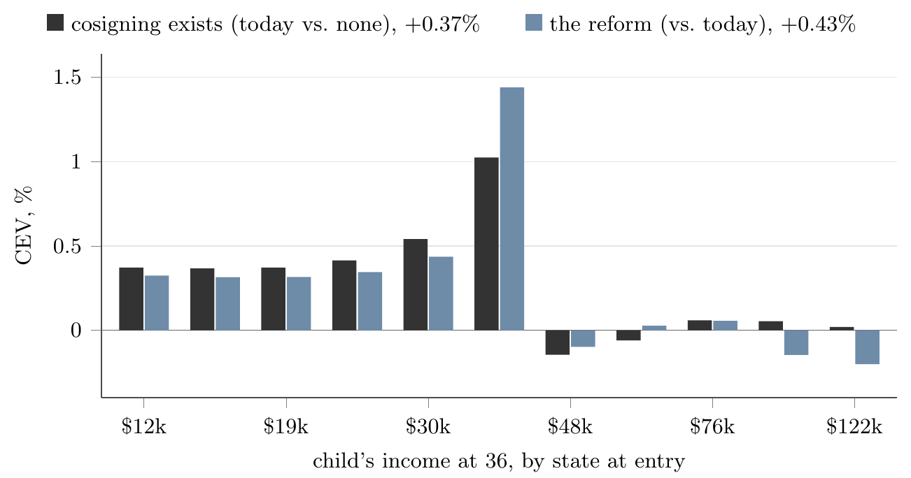
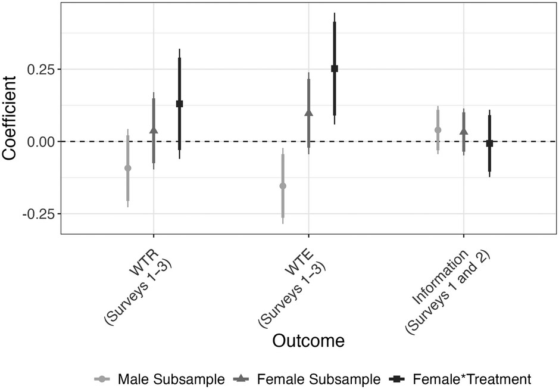
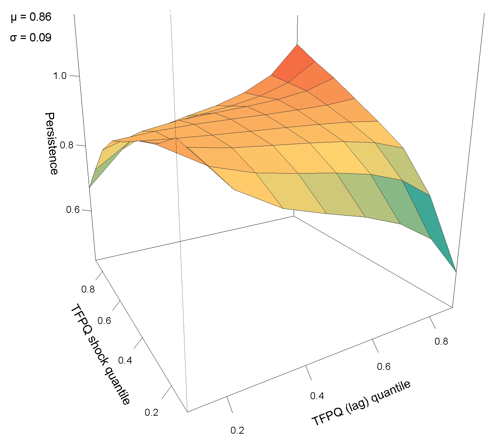
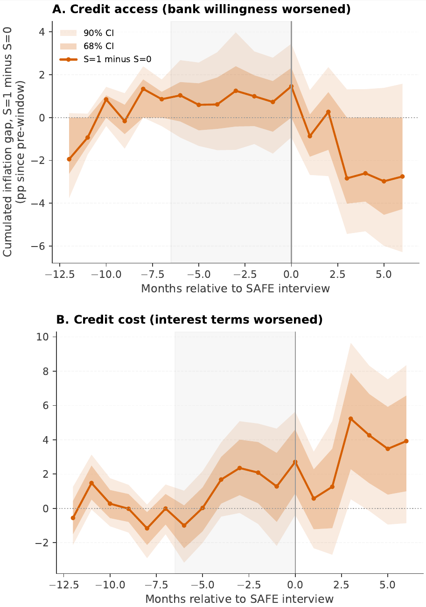

## Research  
 
#### <ins>Job Market Paper</ins>  
 

  

    
      The Unrealized Potential of a Parent's Promise: Cosigned Mortgages and Access to Credit in the United States
     
    
      Presented at: <em>EUI Alumni Conference (2025)</em>, <em>EUI Macro Group (2026)</em>, <em>EUI Microeconometrics Group (2026)</em>, <em>Midwest Macro Winter Meeting (2026)</em>, <em>ECB DG Research (2026)</em> 
      <a href="/assets/gruenewald_jmp.pdf" download="Gruenewald_JMP.pdf">Paper (PDF)</a> | 
      <a href="/assets/supplement.pdf" download="Gruenewald_Online_Appendix.pdf">Online Appendix (PDF)</a> | 
      <a href="/assets/gruenewald_jmp_slides.pdf" download="Gruenewald_JMP_Slides.pdf">Slides (PDF)</a>
    

    

      
Abstract

      

        <!-- your graph -->
        
        <!-- the actual abstract text -->
        

          

            This paper asks how altruistic third-party guarantees shape access to credit, 
            and why they deliver less than they could in the U.S. mortgage market. Parents 
            can make a child's mortgage safer by cosigning, but lenders charge the solo rate, 
            so families overpay 25 basis points. This safety does not come from the parent's 
            information advantage. Unlike a commercial guarantor, the parent also cares about 
            the child's gain, making her not necessarily choose the safest. This introduces 
            adverse selection that dominates the screening. The promise more than offsets the 
            lower cosigning pool quality, as children miss fewer payments when a parent cosigns. 
            Underwriting acknowledges cosigning only partially on admission but not for pricing. 
            Cosigning raises homeownership among young Americans by 0.8 percentage points. 
            Correcting for differences in pool quality and the guarantee nearly doubles access 
            to homeownership without introducing more defaults. It raises welfare, mostly for 
            lower-income children. These results come from a general-equilibrium model with 
            asymmetric information, estimated on the first U.S. measure of parental cosigning, 
            from web-scraped deeds and administrative data.
          

        

      

    

  

---

 
#### <ins>Publications</ins>  

  <!-- Entry #1 -->
  

  

    <a href="https://ejpr.onlinelibrary.wiley.com/doi/10.1111/1475-6765.70017" style="color: Navy; font-weight: bold; text-decoration: none;">
      Does Political Violence Undermine Descriptive Representation? The Case of Women in Politics
    </a>
    - <em> European Journal of Political Research</em> 
    
      joint work with 
      <a href="https://www.jeyhunalizade.com/"><em>Jeyhun Alizade</em></a>, 
      <a href="https://www.fabioellger.com/"><em>Fabio Ellger</em></a> and 
      <a href="https://tichelbaecker.com/"><em>Thomas Tichelbaecker</em></a>
    
  

  

    
Abstract

    

      <!-- your graph -->
      
      <!-- the actual abstract text -->
      

        

          Do attacks against politicians exacerbate the political underrepresentation 
          of marginalized groups? Existing research suggests that candidates and 
          office holders from underrepresented groups are more likely to become 
          targets of political violence, but little is known about the consequences 
          of indirect exposure to political violence for descriptive representation 
          and political ambition. Focusing on the case of women in politics, we study 
          how the prevalence of political violence affects both the descriptive 
          representation and the political ambition of women in Germany – Europe’s 
          largest democracy. Combining an analysis of observational data measuring 
          crimes against politicians with evidence from original and 
          pre-registered survey experiments, we first demonstrate that attacks on 
          political elites are not associated with fewer female candidates on party 
          lists for local elections. Examining political ambitions and underlying 
          microfoundations with different samples of respondents varying in their 
          likelihood of considering political candidacy, we provide survey‐
          experimental evidence that information about the prevalence of political 
          crime does not reduce willingness to run for office or engage in politics 
          among female respondents with high political interest, but may do so among 
          those with low political interest. Taken together, this study highlights 
          resilience of underrepresented groups in face of increasing political 
          violence. However, we also show that political violence may create a 
          pipeline problem if it deters the wider population of women from even 
          considering to run for office.
          

        

      

    

  

---

 
#### <ins>Work in Progress</ins>  

  

    
      Nonlinear Productivity Dynamics
     
    
      with <a href="https://www.eui.eu/people?id=jose-pires-de-sousa-azevedo-ferreira"><em>Alberto Ferreira</em></a> and 
      <a href="https://mccarthydavid.com/"><em>David McCarthy</em></a>  
      Presented at: <em>ECB Early Ideas Seminar (2024)</em>, <em>CREI Macro WG (2025)</em>, <em>EUI Macro Group (2026)</em>
    

    

      
Abstract

      

        <!-- your graph -->
        
        <!-- the actual abstract text -->
        

          

            Models of price setting and firm dynamics almost always assume that firm 
            productivity follows a linear AR(1) with Gaussian shocks. Intuitively, every 
            firm faces the same risk, large shocks are rare, and persistence is constant. 
            We develop a framework to estimate a production function without relying on 
            assumptions associated with the AR(1) process. Furthermore, we jointly estimate 
            the production function with a demand system. Using this framework on Portuguese 
            manufacturers with observed prices and quantities, we find that physical 
            productivity (TFPQ) is neither linear nor Gaussian. Around the center of the 
            distribution, AR(1) dynamics are an accurate description, but not in the tails. 
            There, firms face up to four times the volatility of the median firm, and a large 
            shock can erase much of a firm's history. Relaxing the AR(1) assumption matters 
            for structural modelling as well. Using the estimated process in a vanilla model 
            of labour demand with non-convex adjustment costs, we compare it to the AR(1) 
            world: both processes fit the targeted moments well. However, the parameterization 
            implied by the nonlinear estimation exhibits much lower firing frictions, suggesting 
            that the inaction in employment responses associated with adjustment costs is, to 
            some extent, the result of misspecifying the productivity process. Revenue 
            productivity, finally, is a poor proxy for efficiency: it correlates only weakly 
            with TFPQ, because prices respond more to demand than to efficiency and compress 
            efficiency gaps.
          

        

      

    

  

  
  

  
  

    
      From Credit Terms to Shelf Prices: Financial Frictions and the Margins of Price Adjustment
     
    
      with <a href="https://www.ecb.europa.eu/pub/research/authors/profiles/annalisa-ferrando.en.html"><em>Annalisa Ferrando</em></a>, 
      <a href="https://www.ecb.europa.eu/pub/research/authors/profiles/lukas-henkel.en.html"><em>Lukas Henkel</em></a>, 
      <em>Cecilia Sarchi</em> and 
      <a href="https://sites.google.com/view/tobiasfabianmueller"><em>Tobias Müller</em></a>
    

    

      
Abstract

      

        <!-- your graph -->
        
        <!-- the actual abstract text -->
        

          

            How do financial frictions influence price setting by firms? The literature 
            disagrees even on the sign: constrained firms may raise prices to protect their 
            margins or cut them to raise cash. We link euro-area scanner micro price data to 
            producers' balance sheets and combine this with the answers of the firms in the 
            ECB Survey on the Access to Finance of Enterprises (SAFE). There, we observe both 
            the extensive and intensive margins of credit, and the disagreement in the 
            literature resolves. When banks become less willing to lend, firms raise prices 
            less often and by less to raise cash. When borrowing is more expensive, firms cut 
            prices less often, and inflation rises as they protect their margins. In either 
            case, the firm's response revolves around liquidity, and a menu-cost model with 
            both channels reproduces the responses endogenously. Credit conditions added about 
            1 percentage point to euro-area grocery inflation in 2021–23, mildly amplifying 
            the surge.
          

        

      

    

  

